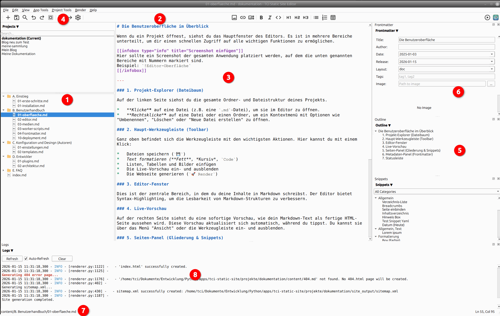

[[toc min_headers="4" title="Contents"]]

When you open a project, the main window is divided into several panels, giving you quick access to all important functions.

## 1. Project Panel

Located at the **top left**, above the file tree.

- **Quick Switch:** Shows recently opened projects. Double-click to switch immediately.
- **Management:** Right-click to rename projects or remove them from the list.
- **Search:** A search field helps you navigate multiple projects.

## 2. Project Explorer (File Tree)

On the **left side**, the entire folder and file structure of your project is displayed.

- **Click** on a `.md` file to open it in the editor.
- **Right-click** on a file or folder for context menu options: Rename, Delete, Create New File.

## 3. Main Toolbar

At the **top**, the toolbar provides single-click access to the most important actions:

- Save files
- Format text (**bold**, *italic*, `code`)
- Insert lists, tables, and images
- Show / hide the live preview
- Generate the website (**Render**)

## 4. Editor Window

The **central area** where you write content in Markdown. The editor provides syntax highlighting to improve readability of Markdown structures.

## 5. Live Preview

On the **right-hand side**, an instant preview shows how your Markdown text will look as a finished HTML page. It updates automatically as you type. Toggle it via the toolbar or the **View** menu.

## 6. Side Panel (Outline & Snippets)

This panel on the **far right** offers two tabs:

- **Outline:** A clickable overview of all headings (`#`, `##`, etc.) in your current document — ideal for quickly navigating long texts.
- **Snippets:** A collection of reusable text modules. Drag and drop them directly into your text.

## 7. Metadata Panel (Front Matter)

**Below the editor**, a form lets you edit the metadata of the current page:

- **Title:** The page title.
- **Date:** The publication date.
- **Layout:** The template to be used.
- **Draft:** If enabled, this page is skipped during rendering.

## 8. Status Bar

At the **very bottom**, the status bar displays the file path, current cursor position, and word count.

## 9. Log Window

**Below the editor**, log information is displayed during rendering — including progress, warnings, and errors.