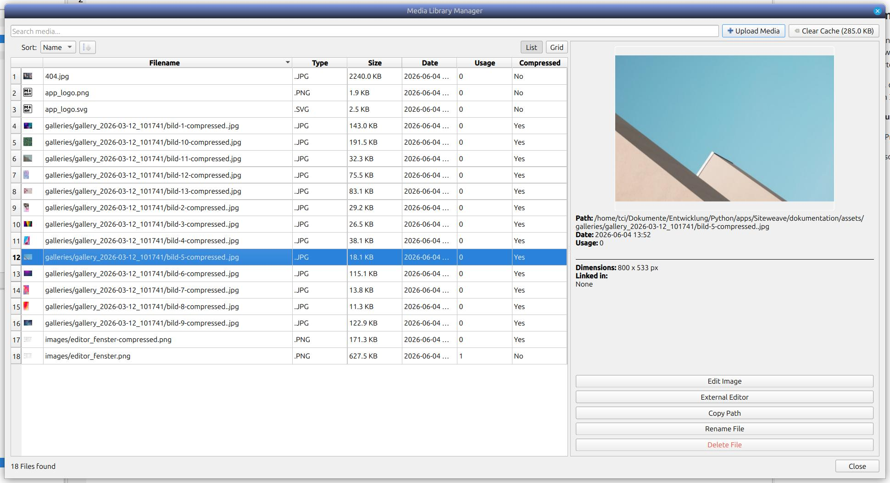
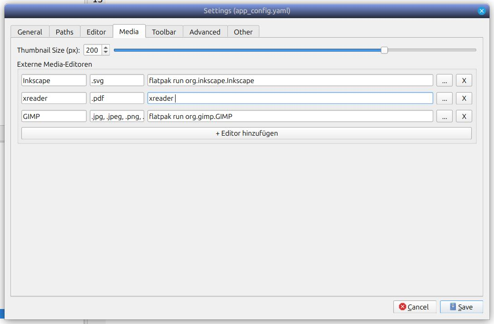

## Media Manager Screen

## Media Manager Configuration

To open files in external applications (such as Flatpak applications like GIMP or Inkscape on Linux) directly from Siteweave, configure external editors in your settings.

Flatpak applications run in a sandbox, so launching them with a file argument uses `flatpak run <App-ID>`.

Ensure Flatpaks are installed with their default IDs. If you want to add other custom editors, find their application IDs by running `flatpak list` in your terminal.

| Name                           | Application ID        |
| ------------------------------ | --------------------- |
| GNU Image Manipulation Program | `org.gimp.GIMP`       | 
| Inkscape                       | `org.inkscape.Inkscape` |